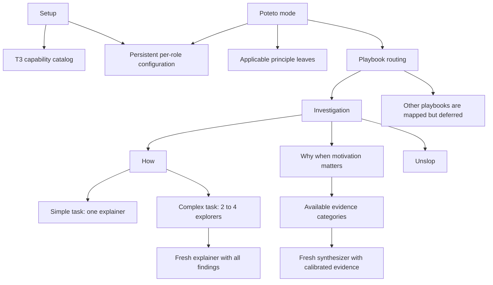

# pstack setup and poteto-mode dependency map

Audit date is October 6, 2026. Upstream is pinned to `df581122cde17e6e27686b5a448bde23e4ad4318`, pstack version `0.15.15`. This document inventories dependencies and proposes the first compatibility boundary. It does not install skills, change model configuration, or establish runtime compatibility.

Archive note, 2026-10-10: this is the original upstream audit. The [jstack implementation plan](./pstack-t3-implementation-plan.md) records subsequent naming and setup decisions. The shipped [configuration contract](../skills/setup-jstack/references/configuration.md) takes precedence over configuration proposals here, including retired-role handling.

## What the entrypoint flow requires

The complete flow starts with persistent per-role configuration, continues through task routing, and resolves principles, workflow skills, prompt templates, and platform operations. The existing `pstack-t3-review` experiment covers a bounded Arena-inspired text panel. It does not implement this flow or substitute for `how`.

Upstream [setup-pstack](https://github.com/cursor/plugins/blob/df581122cde17e6e27686b5a448bde23e4ad4318/pstack/skills/setup-pstack/SKILL.md#L8) discovers Task model slugs, loads the current rule, asks for a budget and role choices, validates them, and overwrites `~/.cursor/rules/pstack-models.mdc` with `alwaysApply: true`. It offers `create-verification-skill` optionally. Setup has 17 role lines, including four list-valued roles. The cross-judge pool selects one judge, while the other three lists determine fan-out. `auto` and `inherit-parent` explicitly mean the parent chat model in upstream, not an automatic cross-provider selector.

[poteto-mode](https://github.com/cursor/plugins/blob/df581122cde17e6e27686b5a448bde23e4ad4318/pstack/skills/poteto-mode/SKILL.md#L11) reads applicable principle leaves, chooses a playbook, puts its steps into todos, and calls further skills. Its [poteto-agent wrapper](https://github.com/cursor/plugins/blob/df581122cde17e6e27686b5a448bde23e4ad4318/pstack/agents/poteto-agent.md#L9) requires reading the complete entrypoint before work and reading each applied principle leaf. The wrapper is behavior, not a model choice. T3 must put that grounding in each child brief rather than assume a Cursor agent registration exists.

## Classification and measured inventory

The pinned tree contains **51 root skills**, comprising **24 principles and 27 other skills**, **23 poteto-mode playbooks**, and **two agent wrappers**. The separate Benny automation pack has three more skill files. It is not a dependency of the two entrypoints and is outside the first slice. These counts come from paths in the pinned snapshot, not the help index or prior estimates.

- **Content** means the instructions or reference can be retained as source material with its relative links. This is not a claim that every instruction applies on every task.
- **Adapter** means platform operations, metadata, permissions, configuration, or paths need explicit T3 translation before execution.
- **Deferred** means it is indexed, but the first Investigation slice must not execute it or silently substitute a different workflow.

## First supported route

The [Investigation playbook](https://github.com/cursor/plugins/blob/df581122cde17e6e27686b5a448bde23e4ad4318/pstack/skills/poteto-mode/playbooks/investigation.md#L5) is explicit. It calls `how`, also calls `why` for motivation questions, emits a read-only throughput checkpoint, returns the prescribed explanation or decision tradeoffs, and applies `unslop`. It forbids PRs and babysitting and postpones `architect` until a separately routed code-change task. A recommendation is not permission to implement it.

[How](https://github.com/cursor/plugins/blob/df581122cde17e6e27686b5a448bde23e4ad4318/pstack/skills/how/SKILL.md#L13) preserves a simple/complex distinction. Simple questions use one explainer which explores and explains. Complex questions partition into two to four explorers, then use a fresh explainer with every report. Preserve [the explorer template](https://github.com/cursor/plugins/blob/df581122cde17e6e27686b5a448bde23e4ad4318/pstack/skills/how/references/explorer-prompt.md) and [the explainer template](https://github.com/cursor/plugins/blob/df581122cde17e6e27686b5a448bde23e4ad4318/pstack/skills/how/references/explainer-prompt.md), including actual file/line evidence, traced data flow, unknowns, and the Overview / Key Concepts / How It Works / Where Things Live / Gotchas structure. Translate named Read/Grep/Glob tools where the provider differs.

[Why](https://github.com/cursor/plugins/blob/df581122cde17e6e27686b5a448bde23e4ad4318/pstack/skills/why/SKILL.md#L56) anchors the question in code and history, then discovers evidence categories. Its seven categories are source control, issue tracker, long-form documents, team chat, infrastructure observability, exception tracking, and analytics warehouse. Source control is required. An unavailable or provably irrelevant category gets a recorded gap. Investigators search their assigned sources; a fresh synthesizer receives all findings and [the epistemic framework](https://github.com/cursor/plugins/blob/df581122cde17e6e27686b5a448bde23e4ad4318/pstack/skills/why/references/epistemics.md). MCP discovery and read permissions need adaptation; merely seeing a connector does not authorize unrelated private searches or external writes.

A first release may implement How before Why, but then it must explicitly reject motivation investigations. It cannot call itself a complete Investigation implementation while silently answering those questions without Why. The complete Investigation target includes both routes, with unavailable evidence categories recorded honestly. The proposed implementation plan stages How first and explicitly blocks motivations until Why is adapted; describe that release as Investigation/How only.

## All principle leaves

The 24 leaves are mostly portable instruction content with cross-links to other leaves or skills. Preserve their source text in the immutable cache. Generated operational copies need policy-aware adaptation where a leaf authorizes broader actions than the session permits. Load only those actually applied and cite only leaves the agent read. A principle that calls for writing a tool, prototype, or test does not override a read-only task, user authorization, or unsupported-route fence. Build the Lever specifically requires a produced file; cite it only when a permitted artifact was actually built, not merely when proposing a tool. Never Block on the Human is a policy-sensitive leaf that must retain the user's actual external-action boundaries rather than importing its default permission grant.

| Principle | Trigger from the leaf description | First-slice handling |
| --- | --- | --- |
| [principle-attack-the-premise](https://github.com/cursor/plugins/blob/df581122cde17e6e27686b5a448bde23e4ad4318/pstack/skills/principle-attack-the-premise/SKILL.md) | two or more fixes that share one premise have failed the same gate. Take a census of which actors hold the imbalance before the next fix, then question the premise instead of writing another fix that assumes it. | Content. Read on applicability; writing remains out of scope. |
| [principle-boundary-discipline](https://github.com/cursor/plugins/blob/df581122cde17e6e27686b5a448bde23e4ad4318/pstack/skills/principle-boundary-discipline/SKILL.md) | wiring validation, error handling, or framework adapters. Concentrate guards at system boundaries (CLI, config, network, external APIs); trust internal types and keep business logic in pure functions. | Content. Read on applicability; writing remains out of scope. |
| [principle-build-the-lever](https://github.com/cursor/plugins/blob/df581122cde17e6e27686b5a448bde23e4ad4318/pstack/skills/principle-build-the-lever/SKILL.md) | any non-trivial work, not just bulk work: edits, migrations, analyses, checks. Build the tool that does it or proves it (codemod, script, generator, or a skill your subagents follow) instead of working by hand. The tool is the artifact a reviewer can rerun. | Conditional content. Requires a produced permitted artifact; do not cite for a read-only proposal. |
| [principle-encode-lessons-in-structure](https://github.com/cursor/plugins/blob/df581122cde17e6e27686b5a448bde23e4ad4318/pstack/skills/principle-encode-lessons-in-structure/SKILL.md) | you catch yourself writing the same instruction a second time, or notice a recurring correction. Encode the rule as a lint, metadata flag, runtime check, or script instead of more text. | Content. Read on applicability; writing remains out of scope. |
| [principle-exhaust-the-design-space](https://github.com/cursor/plugins/blob/df581122cde17e6e27686b5a448bde23e4ad4318/pstack/skills/principle-exhaust-the-design-space/SKILL.md) | facing a novel UI interaction or architectural decision with no precedent in the codebase. Build 2-3 competing prototypes and compare side by side before committing. | Content. Read on applicability; writing remains out of scope. |
| [principle-experience-first](https://github.com/cursor/plugins/blob/df581122cde17e6e27686b5a448bde23e4ad4318/pstack/skills/principle-experience-first/SKILL.md) | product, UX, or feature-scope tradeoffs come up. Choose user delight over implementation convenience; ship fewer polished features over more rough ones. | Content. Read on applicability; writing remains out of scope. |
| [principle-explain-the-number](https://github.com/cursor/plugins/blob/df581122cde17e6e27686b5a448bde23e4ad4318/pstack/skills/principle-explain-the-number/SKILL.md) | you trust, report, or act on a number you measured: a speedup, a regression, a throughput, a latency, or an eval result. Find what limits it, and rule out that it measured something other than the work you think. | Content. Read on applicability; writing remains out of scope. |
| [principle-fix-root-causes](https://github.com/cursor/plugins/blob/df581122cde17e6e27686b5a448bde23e4ad4318/pstack/skills/principle-fix-root-causes/SKILL.md) | debugging. Trace each symptom to its root cause and fix it there; reproduce first, ask why until you reach it, resist nil-check guards that silence crashes. | Content. Read on applicability; writing remains out of scope. |
| [principle-foundational-thinking](https://github.com/cursor/plugins/blob/df581122cde17e6e27686b5a448bde23e4ad4318/pstack/skills/principle-foundational-thinking/SKILL.md) | writing logic: choosing core types and data structures, sequencing scaffold-vs-feature work, asking what concurrent actors share. Get the data structures right so downstream code becomes obvious. | Content. Read on applicability; writing remains out of scope. |
| [principle-guard-the-context-window](https://github.com/cursor/plugins/blob/df581122cde17e6e27686b5a448bde23e4ad4318/pstack/skills/principle-guard-the-context-window/SKILL.md) | context is filling up: large outputs, long files, repeated reads, fan-out planning. Route bulk to subagents; keep summaries in the main thread, not raw payloads. | Content. Read on applicability; writing remains out of scope. |
| [principle-laziness-protocol](https://github.com/cursor/plugins/blob/df581122cde17e6e27686b5a448bde23e4ad4318/pstack/skills/principle-laziness-protocol/SKILL.md) | refactoring, evaluating diff size, or tempted to add abstractions, layers, or signal threading. Bias toward deletion and the smallest change that solves the problem. | Content. Read on applicability; writing remains out of scope. |
| [principle-make-operations-idempotent](https://github.com/cursor/plugins/blob/df581122cde17e6e27686b5a448bde23e4ad4318/pstack/skills/principle-make-operations-idempotent/SKILL.md) | designing commands, lifecycle steps, or processing loops that run amid crashes, restarts, and retries. Converge to the same end state regardless of partial prior runs. | Content. Read on applicability; writing remains out of scope. |
| [principle-migrate-callers-then-delete-legacy-apis](https://github.com/cursor/plugins/blob/df581122cde17e6e27686b5a448bde23e4ad4318/pstack/skills/principle-migrate-callers-then-delete-legacy-apis/SKILL.md) | introducing a new internal API while old callers still exist. Migrate callers and delete the old API in the same wave instead of preserving compatibility layers. | Content. Read on applicability; writing remains out of scope. |
| [principle-minimize-reader-load](https://github.com/cursor/plugins/blob/df581122cde17e6e27686b5a448bde23e4ad4318/pstack/skills/principle-minimize-reader-load/SKILL.md) | reviewing or shaping code that's hard to trace. Count layers between question and answer, and hidden state in the reader's head; collapse one-caller wrappers and shrink mutable scope. | Content. Read on applicability; writing remains out of scope. |
| [principle-model-the-domain](https://github.com/cursor/plugins/blob/df581122cde17e6e27686b5a448bde23e4ad4318/pstack/skills/principle-model-the-domain/SKILL.md) | writing stateful logic, or when code branches a lot or repeats a shape assumption across files. Encode the domain in a structure instead of scattered conditionals. | Content. Read on applicability; writing remains out of scope. |
| [principle-never-block-on-the-human](https://github.com/cursor/plugins/blob/df581122cde17e6e27686b5a448bde23e4ad4318/pstack/skills/principle-never-block-on-the-human/SKILL.md) | tempted to ask 'should I do X?' on reversible work. Proceed, present the result, let the human course-correct after the fact; reserve confirmation for irreversible actions. | Adapter. Narrow action authorization to session/repository policy; writing remains out of scope. |
| [principle-outcome-oriented-execution](https://github.com/cursor/plugins/blob/df581122cde17e6e27686b5a448bde23e4ad4318/pstack/skills/principle-outcome-oriented-execution/SKILL.md) | Apply during planned rewrites and migrations with explicit phase boundaries. Converge on the target architecture; don't preserve smooth intermediate states with throwaway compatibility code. | Content. Read on applicability; writing remains out of scope. |
| [principle-prove-it-works](https://github.com/cursor/plugins/blob/df581122cde17e6e27686b5a448bde23e4ad4318/pstack/skills/principle-prove-it-works/SKILL.md) | Apply after completing a task, before declaring done. Verify against the real artifact (run the feature, read the actual value, inspect the diff), not a proxy, self-report, or 'it compiles.' | Content. Read on applicability; writing remains out of scope. |
| [principle-redesign-from-first-principles](https://github.com/cursor/plugins/blob/df581122cde17e6e27686b5a448bde23e4ad4318/pstack/skills/principle-redesign-from-first-principles/SKILL.md) | integrating a new requirement into an existing design. Redesign as if the requirement had been a foundational assumption from day one, instead of bolting it on. | Content. Read on applicability; writing remains out of scope. |
| [principle-separate-before-serializing-shared-state](https://github.com/cursor/plugins/blob/df581122cde17e6e27686b5a448bde23e4ad4318/pstack/skills/principle-separate-before-serializing-shared-state/SKILL.md) | concurrent actors might write to the same file, branch, key, or state object. Eliminate the sharing first; serialize structurally only when one shared writer is a real invariant. | Content. Read on applicability; writing remains out of scope. |
| [principle-sequence-verifiable-units](https://github.com/cursor/plugins/blob/df581122cde17e6e27686b5a448bde23e4ad4318/pstack/skills/principle-sequence-verifiable-units/SKILL.md) | multi-step work (sweeps, migrations, runs of similar edits) and to how you stack commits and PRs. Break work into small units that each end in a verifiable state, check each before the next, and order delivery so the sequence proves itself to a reviewer. | Content. Read on applicability; writing remains out of scope. |
| [principle-subtract-before-you-add](https://github.com/cursor/plugins/blob/df581122cde17e6e27686b5a448bde23e4ad4318/pstack/skills/principle-subtract-before-you-add/SKILL.md) | sequencing an addition, refactor, or rewrite. Remove dead code, redundant validators, and stub references first, then build on the simpler base. | Content. Read on applicability; writing remains out of scope. |
| [principle-test-behavior-not-implementation](https://github.com/cursor/plugins/blob/df581122cde17e6e27686b5a448bde23e4ad4318/pstack/skills/principle-test-behavior-not-implementation/SKILL.md) | you write, change, or keep a test. Call the code the way its users do and assert the result they observe against a literal expected value. If the test would still pass when every imported function returns undefined, rewrite the assertion or delete the test. | Content. Read on applicability; writing remains out of scope. |
| [principle-type-system-discipline](https://github.com/cursor/plugins/blob/df581122cde17e6e27686b5a448bde23e4ad4318/pstack/skills/principle-type-system-discipline/SKILL.md) | designing types, reviewing a function signature, or writing code in any statically-typed language. Make illegal states unrepresentable, brand semantic primitives, parse external data at boundaries, refuse to lie to the compiler, exhaust variants, derive from authoritative schemas. | Content. Read on applicability; writing remains out of scope. |

## All non-principle skills

| Skill | Dependencies / responsibilities | Classification |
| --- | --- | --- |
| [architect](https://github.com/cursor/plugins/blob/df581122cde17e6e27686b5a448bde23e4ad4318/pstack/skills/architect/SKILL.md) | how; why when ownership changes; arena; interrogate; three design references. | Deferred. Shape sketch and implementation are not Investigation. |
| [arena](https://github.com/cursor/plugins/blob/df581122cde17e6e27686b5a448bde23e4ad4318/pstack/skills/arena/SKILL.md) | Role lists; isolated outputs; fresh judge; parent pick, graft, verify. | Deferred full workflow. Existing review experiment is only a bounded subset. |
| [automate-me](https://github.com/cursor/plugins/blob/df581122cde17e6e27686b5a448bde23e4ad4318/pstack/skills/automate-me/SKILL.md) | Own transcripts; personal -mode locations; create-skill; unslop. | Deferred. Personalization and authoring paths require adaptation. |
| [benchmark-checklist](https://github.com/cursor/plugins/blob/df581122cde17e6e27686b5a448bde23e4ad4318/pstack/skills/benchmark-checklist/SKILL.md) | Explain the Number principle; real measurement tools; performance artifacts. | Content with task-specific tools. Deferred execution for first Investigation. |
| [blast-radius](https://github.com/cursor/plugins/blob/df581122cde17e6e27686b5a448bde23e4ad4318/pstack/skills/blast-radius/SKILL.md) | Read the changed code and prove the external behavioral dependency. | Deferred specialized proof workflow. Not an entrypoint call for this slice. |
| [bro](https://github.com/cursor/plugins/blob/df581122cde17e6e27686b5a448bde23e4ad4318/pstack/skills/bro/SKILL.md) | Re-explain last reply in plain words. | Content. Not automatically invoked by the entrypoints. |
| [correct](https://github.com/cursor/plugins/blob/df581122cde17e6e27686b5a448bde23e4ad4318/pstack/skills/correct/SKILL.md) | Architecture/type/lint/test fixes; rule table. | Deferred mutation workflow. |
| [create-verification-skill](https://github.com/cursor/plugins/blob/df581122cde17e6e27686b5a448bde23e4ad4318/pstack/skills/create-verification-skill/SKILL.md) | Project discovery; .cursor/skills/verify-*; app driver; feature-map examples. | Deferred optional setup offer. Paths, driver, proof, cleanup need adaptation. |
| [figure-it-out](https://github.com/cursor/plugins/blob/df581122cde17e6e27686b5a448bde23e4ad4318/pstack/skills/figure-it-out/SKILL.md) | poteto-mode principles; architect/arena; show-me-your-work; verify. | Deferred. Bespoke long-run routing is unsupported initially. |
| [how](https://github.com/cursor/plugins/blob/df581122cde17e6e27686b5a448bde23e4ad4318/pstack/skills/how/SKILL.md) | Explorer and explainer templates; model rule. | Adapter; required. Simple and complex branches with fresh tasks. |
| [interrogate](https://github.com/cursor/plugins/blob/df581122cde17e6e27686b5a448bde23e4ad4318/pstack/skills/interrogate/SKILL.md) | Independent reviewers; four review references; lead judgment. | Deferred. Diff review and adversarial design need a separate route. |
| [maintain-verification-skill](https://github.com/cursor/plugins/blob/df581122cde17e6e27686b5a448bde23e4ad4318/pstack/skills/maintain-verification-skill/SKILL.md) | Existing verify skill; per-feature read wave; coordinator live driving. | Deferred. Live app and skill edits are outside Investigation. |
| [make-bot-ui](https://github.com/cursor/plugins/blob/df581122cde17e6e27686b5a448bde23e4ad4318/pstack/skills/make-bot-ui/SKILL.md) | Cursor routine creation; webhook; sender secret; local UI server; Tailscale. | Deferred. Cursor routines have no established equivalent here. |
| [no-comments](https://github.com/cursor/plugins/blob/df581122cde17e6e27686b5a448bde23e4ad4318/pstack/skills/no-comments/SKILL.md) | Comment Sicko wrapper; architect; in-scope root-cause fixes. | Deferred. Registered wrapper and mutations are unavailable in first slice. |
| [poteto-help](https://github.com/cursor/plugins/blob/df581122cde17e6e27686b5a448bde23e4ad4318/pstack/skills/poteto-help/SKILL.md) | Setup; mode; skill index; two help references; guide pages; Cursor custom modes. | Adapter for later user help. Must describe subset, not advertise every route. |
| [poteto-mode](https://github.com/cursor/plugins/blob/df581122cde17e6e27686b5a448bde23e4ad4318/pstack/skills/poteto-mode/SKILL.md) | Principles; 23 playbooks; workflow triggers; poteto-agent. | Adapter; required. Explicit support matrix and dependency resolver. |
| [recall](https://github.com/cursor/plugins/blob/df581122cde17e6e27686b5a448bde23e4ad4318/pstack/skills/recall/SKILL.md) | Workspace transcript search; why; session-pickup; automate-me. | Deferred. Do not glob unrelated chat history. |
| [reflect](https://github.com/cursor/plugins/blob/df581122cde17e6e27686b5a448bde23e4ad4318/pstack/skills/reflect/SKILL.md) | Workspace transcript; three reviewers and synthesizer; create-skill; approval. | Deferred. Transcript access and authoring lifecycle need adapters. |
| [setup-pstack](https://github.com/cursor/plugins/blob/df581122cde17e6e27686b5a448bde23e4ad4318/pstack/skills/setup-pstack/SKILL.md) | Entry point; optional create-verification-skill. | Adapter; required. Persistent role settings, catalog options, aliases, budget confirmation. |
| [show-me-your-work](https://github.com/cursor/plugins/blob/df581122cde17e6e27686b5a448bde23e4ad4318/pstack/skills/show-me-your-work/SKILL.md) | Decision-log template; log.sh; workspace transcript audit; cross-model review. | Deferred complete workflow. First-slice receipts do not claim its transcript audit. |
| [swarm](https://github.com/cursor/plugins/blob/df581122cde17e6e27686b5a448bde23e4ad4318/pstack/skills/swarm/SKILL.md) | Partition/race policies; cloud Task placement; per-role worker model. | Deferred. Do not replace How explorers with a generic swarm. |
| [tdd](https://github.com/cursor/plugins/blob/df581122cde17e6e27686b5a448bde23e4ad4318/pstack/skills/tdd/SKILL.md) | Failing-test-first code edits. | Content as recipe, deferred execution. |
| [teach](https://github.com/cursor/plugins/blob/df581122cde17e6e27686b5a448bde23e4ad4318/pstack/skills/teach/SKILL.md) | how; why; unslop; progressive explanation. | Deferred optional caller. Existing How/Why work can support later teaching. |
| [technical-writing](https://github.com/cursor/plugins/blob/df581122cde17e6e27686b5a448bde23e4ad4318/pstack/skills/technical-writing/SKILL.md) | Diátaxis/style guidance; unslop. | Content. It applies when authoring the adaptation documents, not an extra mandatory Investigation stage. |
| [typescript-best-practices](https://github.com/cursor/plugins/blob/df581122cde17e6e27686b5a448bde23e4ad4318/pstack/skills/typescript-best-practices/SKILL.md) | TypeScript conventions; patterns; linked principles. | Content as source, deferred execution; repository conventions remain authoritative. |
| [unslop](https://github.com/cursor/plugins/blob/df581122cde17e6e27686b5a448bde23e4ad4318/pstack/skills/unslop/SKILL.md) | Prose rules. | Content; required on the final answer. |
| [why](https://github.com/cursor/plugins/blob/df581122cde17e6e27686b5a448bde23e4ad4318/pstack/skills/why/SKILL.md) | Seven source categories; epistemics; investigators; synthesizer. | Adapter; required for motivations. Available read tools and source gaps. |

## All playbooks and route fences

Only Investigation is enabled in the first slice. Every other matched route returns its unsupported status and required prerequisites before delegating or writing. A route inventory is not permission to run it.

| Playbook | Called workflows and platform operations | First slice |
| --- | --- | --- |
| [authoring-a-skill](https://github.com/cursor/plugins/blob/df581122cde17e6e27686b5a448bde23e4ad4318/pstack/skills/poteto-mode/playbooks/authoring-a-skill.md) | create-skill built-in; validate; Opening a PR. | Deferred; reject route. |
| [autonomous-run](https://github.com/cursor/plugins/blob/df581122cde17e6e27686b5a448bde23e4ad4318/pstack/skills/poteto-mode/playbooks/autonomous-run.md) | /loop built-in; repeated verify/commit; show-me-your-work. | Deferred; reject route. |
| [autopilot-full](https://github.com/cursor/plugins/blob/df581122cde17e6e27686b5a448bde23e4ad4318/pstack/skills/poteto-mode/playbooks/autopilot-full.md) | Cloud owners; swarm proof; Bugbot; deslop; no-comments; babysit; shipping patch-id; hourly /loop; forge writes. | Deferred; reject route. |
| [autopilot-stack](https://github.com/cursor/plugins/blob/df581122cde17e6e27686b5a448bde23e4ad4318/pstack/skills/poteto-mode/playbooks/autopilot-stack.md) | Autopilot-full owner and tick rules; swarm verdicts; single topology writer; forge pushes/retargets. | Deferred; reject route. |
| [babysit](https://github.com/cursor/plugins/blob/df581122cde17e6e27686b5a448bde23e4ad4318/pstack/skills/poteto-mode/playbooks/babysit.md) | Forge checks; watch-pr; bugbot-triage; retry policy; Shipping handoff. | Deferred; reject route. |
| [bug-fix](https://github.com/cursor/plugins/blob/df581122cde17e6e27686b5a448bde23e4ad4318/pstack/skills/poteto-mode/playbooks/bug-fix.md) | Control driver; how; why; architect on boundaries; delegated fix; tdd; Opening a PR. | Deferred; reject route. |
| [eval](https://github.com/cursor/plugins/blob/df581122cde17e6e27686b5a448bde23e4ad4318/pstack/skills/poteto-mode/playbooks/eval.md) | Blinded sanitized environments; Arena phases B/C; transcript-based chain proof. | Deferred; reject route. |
| [feature](https://github.com/cursor/plugins/blob/df581122cde17e6e27686b5a448bde23e4ad4318/pstack/skills/poteto-mode/playbooks/feature.md) | how; architect; scoped code delegates or arena; control verification; interrogate; Opening a PR. | Deferred; reject route. |
| [hillclimb](https://github.com/cursor/plugins/blob/df581122cde17e6e27686b5a448bde23e4ad4318/pstack/skills/poteto-mode/playbooks/hillclimb.md) | how; benchmark-checklist; measurement harness; show-me-your-work; isolated workers; Perf mantras; Autonomous wake; Opening a PR. | Deferred; reject route. |
| [investigation](https://github.com/cursor/plugins/blob/df581122cde17e6e27686b5a448bde23e4ad4318/pstack/skills/poteto-mode/playbooks/investigation.md) | how; why for motivation; read-only checkpoint; unslop; cited explanation or tradeoffs. | Adapter; enabled after verification. |
| [multi-phase-plan](https://github.com/cursor/plugins/blob/df581122cde17e6e27686b5a448bde23e4ad4318/pstack/skills/poteto-mode/playbooks/multi-phase-plan.md) | Prototype; poteto-agent; technical-writing; unslop; check-plan.mjs; swarm/control verification recipes; Autopilot/Orchestrate plan. | Deferred; reject route. |
| [opening-a-pr](https://github.com/cursor/plugins/blob/df581122cde17e6e27686b5a448bde23e4ad4318/pstack/skills/poteto-mode/playbooks/opening-a-pr.md) | Bound worktree; interrogate; deslop; no-comments; technical-writing; unslop; gh/Origin; PR readiness/base handling. | Deferred; reject route. |
| [orchestrate](https://github.com/cursor/plugins/blob/df581122cde17e6e27686b5a448bde23e4ad4318/pstack/skills/poteto-mode/playbooks/orchestrate.md) | Cloud workers; local store; Task lifecycle; orch CLI; preferences; verification ledger; stacker/gt; watchers; show-me-your-work. | Deferred; reject route. |
| [pause-safely](https://github.com/cursor/plugins/blob/df581122cde17e6e27686b5a448bde23e4ad4318/pstack/skills/poteto-mode/playbooks/pause-safely.md) | Cancel children; local WIP commit; durable off-context checkpoint; show-me-your-work pointer. | Deferred; reject route. |
| [perf-issue](https://github.com/cursor/plugins/blob/df581122cde17e6e27686b5a448bde23e4ad4318/pstack/skills/poteto-mode/playbooks/perf-issue.md) | Control baseline; benchmark-checklist; how; architect; delegates; captured trace; Opening a PR. | Deferred; reject route. |
| [prototype](https://github.com/cursor/plugins/blob/df581122cde17e6e27686b5a448bde23e4ad4318/pstack/skills/poteto-mode/playbooks/prototype.md) | Scratch files; empirical observation or control screenshots; architectural alternative handoff to Feature/architect. | Deferred; reject route. |
| [refactoring](https://github.com/cursor/plugins/blob/df581122cde17e6e27686b5a448bde23e4ad4318/pstack/skills/poteto-mode/playbooks/refactoring.md) | how; contract pin; applicable principles; architect; scoped delegates; equivalence proof; Opening a PR. | Deferred; reject route. |
| [runtime-forensics](https://github.com/cursor/plugins/blob/df581122cde17e6e27686b5a448bde23e4ad4318/pstack/skills/poteto-mode/playbooks/runtime-forensics.md) | Live control driver/CDP; instrumentation; bulk artifact delegate; cited source diagnosis. | Deferred; reject route. |
| [session-pickup](https://github.com/cursor/plugins/blob/df581122cde17e6e27686b5a448bde23e4ad4318/pstack/skills/poteto-mode/playbooks/session-pickup.md) | Active workspace transcripts/cloud URL/pushed branch; scoped delegate; inherited state; reroute; real verification. | Deferred; reject route. |
| [shipping](https://github.com/cursor/plugins/blob/df581122cde17e6e27686b5a448bde23e4ad4318/pstack/skills/poteto-mode/playbooks/shipping.md) | Independent cloud verifier per PR; control driver; patch-id/build receipt validity; forge merge; watch-pr and /loop. | Deferred; reject route. |
| [trace-forensics](https://github.com/cursor/plugins/blob/df581122cde17e6e27686b5a448bde23e4ad4318/pstack/skills/poteto-mode/playbooks/trace-forensics.md) | Capture parser/sqlite; bulk delegate; symbol mapping; paired artifact comparison; Bug fix/Perf handoff. | Deferred; reject route. |
| [visual-parity](https://github.com/cursor/plugins/blob/df581122cde17e6e27686b5a448bde23e4ad4318/pstack/skills/poteto-mode/playbooks/visual-parity.md) | Frozen screenshot baseline; isolated writers; image diff; /loop; Opening a PR. | Deferred; reject route. |
| [worktree-cleanup](https://github.com/cursor/plugins/blob/df581122cde17e6e27686b5a448bde23e4ad4318/pstack/skills/poteto-mode/playbooks/worktree-cleanup.md) | worktree-audit.sh; Cursor sidebar/transcripts; explicit deletion safety; git removals; Apple simulator tooling. | Deferred; reject route. |

## External dependencies and required translations

| Upstream assumption | T3 adaptation or limit | Evidence |
| --- | --- | --- |
| Task, subagent_type, generalPurpose, poteto-agent, run_in_background, model slug | Use the live catalog for providerInstanceId, model, and options. Encode wrapper grounding explicitly; keep each taskId and use fresh consolidated task briefs. No invented Cursor fields. | [skills/poteto-mode/SKILL.md](https://github.com/cursor/plugins/blob/df581122cde17e6e27686b5a448bde23e4ad4318/pstack/skills/poteto-mode/SKILL.md#L93) |
| readonly true versus agent mode retains MCP | Separate no-write scope from permissions and connector access. role review is not filesystem enforcement. Verify available provider permissions before claiming enforced read-only. | [skills/why/SKILL.md](https://github.com/cursor/plugins/blob/df581122cde17e6e27686b5a448bde23e4ad4318/pstack/skills/why/SKILL.md#L80) |
| Always-applied .mdc model rule and suffix-based effort | Persist structured secret-free role settings; read them explicitly each run; validate against current advertised model/options. Do not synthesize reasoning suffixes for T3 models. | [skills/setup-pstack/SKILL.md](https://github.com/cursor/plugins/blob/df581122cde17e6e27686b5a448bde23e4ad4318/pstack/skills/setup-pstack/SKILL.md#L29) |
| auto / inherit-parent | Resolve explicitly to the coordinating provider/model/options when observable. Block alias use if the parent identity cannot be resolved. Do not silently pick another provider. | [skills/setup-pstack/SKILL.md](https://github.com/cursor/plugins/blob/df581122cde17e6e27686b5a448bde23e4ad4318/pstack/skills/setup-pstack/SKILL.md#L47) |
| AskQuestion and todos | Use host-supported user input for actual budget/preferences; preserve accepted choices. Use supported planning tools or an explicit checklist. Never treat elapsed time as approval. | [skills/setup-pstack/SKILL.md](https://github.com/cursor/plugins/blob/df581122cde17e6e27686b5a448bde23e4ad4318/pstack/skills/setup-pstack/SKILL.md#L22) |
| File pointers, templates, and sibling outputs | Provide absolute readable paths, original brief, directives, grounding, configuration, and needed prior reports to every child. No copied parent history is assumed. | [skills/how/SKILL.md](https://github.com/cursor/plugins/blob/df581122cde17e6e27686b5a448bde23e4ad4318/pstack/skills/how/SKILL.md#L44) |
| Cursor cloud environment and per-Task worktree placement | delegate_task inherits the caller workspace. No isolation claim from shell cd/git worktree add. Top-level bound workspace launches require an explicit user request; writers deferred. | [skills/poteto-mode/playbooks/orchestrate.md](https://github.com/cursor/plugins/blob/df581122cde17e6e27686b5a448bde23e4ad4318/pstack/skills/poteto-mode/playbooks/orchestrate.md#L17) |
| Resume/send/drain semantics | Fresh T3 delegation per new round with its own taskId. Never use childThreadId as an ordinary conversation for review continuation. Audit terminal results after notifications. | [skills/poteto-mode/SKILL.md](https://github.com/cursor/plugins/blob/df581122cde17e6e27686b5a448bde23e4ad4318/pstack/skills/poteto-mode/SKILL.md#L99) |
| Custom Mode frontmatter and poteto-agent registration | Entry metadata may be host-specific. Until persistence is proven, explicitly invoke the entrypoint per task and ground every child; no claim of always-active mode. | [skills/poteto-help/SKILL.md](https://github.com/cursor/plugins/blob/df581122cde17e6e27686b5a448bde23e4ad4318/pstack/skills/poteto-help/SKILL.md#L49) |
| Cursor MCP map or mcps directory | Discover actual exposed tools/connectors and authorized sources. Record absent categories. Do not fabricate connector names or inherit MCP availability from the parent. | [skills/why/SKILL.md](https://github.com/cursor/plugins/blob/df581122cde17e6e27686b5a448bde23e4ad4318/pstack/skills/why/SKILL.md#L64) |
| Team Kit deslop, control-ui, control-cli | Separate external dependencies. Map browser work to T3 preview tools and terminal work to supported PTY/commands, then prove equivalence per task. Never fabricate Team Kit installation. | [skills/poteto-mode/SKILL.md](https://github.com/cursor/plugins/blob/df581122cde17e6e27686b5a448bde23e4ad4318/pstack/skills/poteto-mode/SKILL.md#L28) |
| Cursor create-skill and /loop built-ins | Authoring needs an available host skill; scheduling/watchers need explicit T3 support and user scope. Recurring schedules are not a transparent temporary loop. | [skills/poteto-help/SKILL.md](https://github.com/cursor/plugins/blob/df581122cde17e6e27686b5a448bde23e4ad4318/pstack/skills/poteto-help/SKILL.md#L104) |
| Cursor active workspace transcripts, agent store, rules/skills paths | Map scoped activity/records from the current host only. First Investigation reads supplied source files and task receipts; transcript mining, store migration, and personalization remain deferred. | [skills/poteto-mode/playbooks/session-pickup.md](https://github.com/cursor/plugins/blob/df581122cde17e6e27686b5a448bde23e4ad4318/pstack/skills/poteto-mode/playbooks/session-pickup.md#L5) |
| gh / Origin / Graphite and PR writes | Use current forge capabilities and approval policy. Register worked PRs with T3. Where watch_pull_request exists, use its wake rather than a custom polling loop. | [skills/poteto-mode/playbooks/opening-a-pr.md](https://github.com/cursor/plugins/blob/df581122cde17e6e27686b5a448bde23e4ad4318/pstack/skills/poteto-mode/playbooks/opening-a-pr.md#L26) |
| Autonomy permits team chat/ticket external actions without asking | Override with session and repository authorization. No workflow expands the user scope. First Investigation forbids external writes. | [skills/poteto-mode/SKILL.md](https://github.com/cursor/plugins/blob/df581122cde17e6e27686b5a448bde23e4ad4318/pstack/skills/poteto-mode/SKILL.md#L81) |
| Cursor routine/webhook API and Apple simulator tooling | No first-slice mapping; explicit unsupported dependencies rather than a generic substitute. | [skills/make-bot-ui/SKILL.md](https://github.com/cursor/plugins/blob/df581122cde17e6e27686b5a448bde23e4ad4318/pstack/skills/make-bot-ui/SKILL.md#L25) |

The T3 statements above follow the live injected orchestration contract available to this session. Tool presence and provider permissions must still be checked in the target coordinating session. They are not a promise that stable or differently configured T3 installations expose the same tools.

## Reference and executable dependency inventory

Retain relative layout when source material is copied. Resolve references from the selected skill directory, never from the website checkout or an assumed working directory. The complete reference-file list is below. Not all files are required by the first slice.

- `architect`: [references/design-red-flags.md](https://github.com/cursor/plugins/blob/df581122cde17e6e27686b5a448bde23e4ad4318/pstack/skills/architect/references/design-red-flags.md), [references/rationale-template.md](https://github.com/cursor/plugins/blob/df581122cde17e6e27686b5a448bde23e4ad4318/pstack/skills/architect/references/rationale-template.md), [references/runner-prompt.md](https://github.com/cursor/plugins/blob/df581122cde17e6e27686b5a448bde23e4ad4318/pstack/skills/architect/references/runner-prompt.md).
- `create-verification-skill`: [references/feature-map-example/README.md](https://github.com/cursor/plugins/blob/df581122cde17e6e27686b5a448bde23e4ad4318/pstack/skills/create-verification-skill/references/feature-map-example/README.md), [references/feature-map-example/create-note.md](https://github.com/cursor/plugins/blob/df581122cde17e6e27686b5a448bde23e4ad4318/pstack/skills/create-verification-skill/references/feature-map-example/create-note.md), [references/feature-map-example/search.md](https://github.com/cursor/plugins/blob/df581122cde17e6e27686b5a448bde23e4ad4318/pstack/skills/create-verification-skill/references/feature-map-example/search.md).
- `how`: [references/explainer-prompt.md](https://github.com/cursor/plugins/blob/df581122cde17e6e27686b5a448bde23e4ad4318/pstack/skills/how/references/explainer-prompt.md), [references/explorer-prompt.md](https://github.com/cursor/plugins/blob/df581122cde17e6e27686b5a448bde23e4ad4318/pstack/skills/how/references/explorer-prompt.md).
- `interrogate`: [references/code-quality-review.md](https://github.com/cursor/plugins/blob/df581122cde17e6e27686b5a448bde23e4ad4318/pstack/skills/interrogate/references/code-quality-review.md), [references/lead-judgment.md](https://github.com/cursor/plugins/blob/df581122cde17e6e27686b5a448bde23e4ad4318/pstack/skills/interrogate/references/lead-judgment.md), [references/reviewer-prompt.md](https://github.com/cursor/plugins/blob/df581122cde17e6e27686b5a448bde23e4ad4318/pstack/skills/interrogate/references/reviewer-prompt.md), [references/rubric.md](https://github.com/cursor/plugins/blob/df581122cde17e6e27686b5a448bde23e4ad4318/pstack/skills/interrogate/references/rubric.md).
- `poteto-help`: [references/prompting.md](https://github.com/cursor/plugins/blob/df581122cde17e6e27686b5a448bde23e4ad4318/pstack/skills/poteto-help/references/prompting.md), [references/recipes.md](https://github.com/cursor/plugins/blob/df581122cde17e6e27686b5a448bde23e4ad4318/pstack/skills/poteto-help/references/recipes.md).
- `poteto-mode`: [references/bugbot-triage.md](https://github.com/cursor/plugins/blob/df581122cde17e6e27686b5a448bde23e4ad4318/pstack/skills/poteto-mode/references/bugbot-triage.md).
- `reflect`: [references/divergent-reviewer.md](https://github.com/cursor/plugins/blob/df581122cde17e6e27686b5a448bde23e4ad4318/pstack/skills/reflect/references/divergent-reviewer.md), [references/judgment-reviewer.md](https://github.com/cursor/plugins/blob/df581122cde17e6e27686b5a448bde23e4ad4318/pstack/skills/reflect/references/judgment-reviewer.md), [references/synthesizer.md](https://github.com/cursor/plugins/blob/df581122cde17e6e27686b5a448bde23e4ad4318/pstack/skills/reflect/references/synthesizer.md), [references/tooling-reviewer.md](https://github.com/cursor/plugins/blob/df581122cde17e6e27686b5a448bde23e4ad4318/pstack/skills/reflect/references/tooling-reviewer.md).
- `show-me-your-work`: [references/decision-log-template.tsv](https://github.com/cursor/plugins/blob/df581122cde17e6e27686b5a448bde23e4ad4318/pstack/skills/show-me-your-work/references/decision-log-template.tsv).
- `typescript-best-practices`: [references/patterns.md](https://github.com/cursor/plugins/blob/df581122cde17e6e27686b5a448bde23e4ad4318/pstack/skills/typescript-best-practices/references/patterns.md).
- `why`: [references/epistemics.md](https://github.com/cursor/plugins/blob/df581122cde17e6e27686b5a448bde23e4ad4318/pstack/skills/why/references/epistemics.md), [references/investigator-prompt.md](https://github.com/cursor/plugins/blob/df581122cde17e6e27686b5a448bde23e4ad4318/pstack/skills/why/references/investigator-prompt.md), [references/source-playbook.md](https://github.com/cursor/plugins/blob/df581122cde17e6e27686b5a448bde23e4ad4318/pstack/skills/why/references/source-playbook.md), [references/sources/code-archaeology.md](https://github.com/cursor/plugins/blob/df581122cde17e6e27686b5a448bde23e4ad4318/pstack/skills/why/references/sources/code-archaeology.md), [references/sources/databricks.md](https://github.com/cursor/plugins/blob/df581122cde17e6e27686b5a448bde23e4ad4318/pstack/skills/why/references/sources/databricks.md), [references/sources/datadog.md](https://github.com/cursor/plugins/blob/df581122cde17e6e27686b5a448bde23e4ad4318/pstack/skills/why/references/sources/datadog.md), [references/sources/incident-postmortem.md](https://github.com/cursor/plugins/blob/df581122cde17e6e27686b5a448bde23e4ad4318/pstack/skills/why/references/sources/incident-postmortem.md), [references/sources/linear.md](https://github.com/cursor/plugins/blob/df581122cde17e6e27686b5a448bde23e4ad4318/pstack/skills/why/references/sources/linear.md), [references/sources/notion.md](https://github.com/cursor/plugins/blob/df581122cde17e6e27686b5a448bde23e4ad4318/pstack/skills/why/references/sources/notion.md), [references/sources/sentry.md](https://github.com/cursor/plugins/blob/df581122cde17e6e27686b5a448bde23e4ad4318/pstack/skills/why/references/sources/sentry.md), [references/sources/slack.md](https://github.com/cursor/plugins/blob/df581122cde17e6e27686b5a448bde23e4ad4318/pstack/skills/why/references/sources/slack.md), [references/synthesizer-prompt.md](https://github.com/cursor/plugins/blob/df581122cde17e6e27686b5a448bde23e4ad4318/pstack/skills/why/references/synthesizer-prompt.md).

Executable dependencies under poteto-mode are `scripts/bootstrap.ts`, `scripts/check-plan.mjs`, `scripts/worktree-audit.sh`, the `scripts/orch/` bookkeeping CLI and store, and `scripts/watch-pr/` including its executable wrapper and GitHub/policy modules. Their package manifest and lockfile are dependencies too. `show-me-your-work` owns `scripts/log.sh`. None is required to answer the first read-only Investigation, and none was run by this audit.

- [skills/poteto-mode/scripts/bootstrap.ts](https://github.com/cursor/plugins/blob/df581122cde17e6e27686b5a448bde23e4ad4318/pstack/skills/poteto-mode/scripts/bootstrap.ts).
- [skills/poteto-mode/scripts/check-plan.mjs](https://github.com/cursor/plugins/blob/df581122cde17e6e27686b5a448bde23e4ad4318/pstack/skills/poteto-mode/scripts/check-plan.mjs).
- [skills/poteto-mode/scripts/worktree-audit.sh](https://github.com/cursor/plugins/blob/df581122cde17e6e27686b5a448bde23e4ad4318/pstack/skills/poteto-mode/scripts/worktree-audit.sh).
- [skills/poteto-mode/scripts/orch/orch.ts](https://github.com/cursor/plugins/blob/df581122cde17e6e27686b5a448bde23e4ad4318/pstack/skills/poteto-mode/scripts/orch/orch.ts).
- [skills/poteto-mode/scripts/orch/store.ts](https://github.com/cursor/plugins/blob/df581122cde17e6e27686b5a448bde23e4ad4318/pstack/skills/poteto-mode/scripts/orch/store.ts).
- [skills/poteto-mode/scripts/watch-pr/watch-pr](https://github.com/cursor/plugins/blob/df581122cde17e6e27686b5a448bde23e4ad4318/pstack/skills/poteto-mode/scripts/watch-pr/watch-pr).
- [skills/poteto-mode/scripts/watch-pr/cli.ts](https://github.com/cursor/plugins/blob/df581122cde17e6e27686b5a448bde23e4ad4318/pstack/skills/poteto-mode/scripts/watch-pr/cli.ts).
- [skills/poteto-mode/scripts/package.json](https://github.com/cursor/plugins/blob/df581122cde17e6e27686b5a448bde23e4ad4318/pstack/skills/poteto-mode/scripts/package.json).
- [skills/show-me-your-work/scripts/log.sh](https://github.com/cursor/plugins/blob/df581122cde17e6e27686b5a448bde23e4ad4318/pstack/skills/show-me-your-work/scripts/log.sh).
- [agents/comment-sicko.md](https://github.com/cursor/plugins/blob/df581122cde17e6e27686b5a448bde23e4ad4318/pstack/agents/comment-sicko.md).

The guide pages and poteto-help references are documentation dependencies for help, not hidden execution prerequisites for every task. The separate Benny pack targets Cursor Automations with Slack/webhook setup and .cursor paths; it is deferred, with no implied T3 automation support.

## Ambiguities to preserve in the implementation plan

- [Opening a PR](https://github.com/cursor/plugins/blob/df581122cde17e6e27686b5a448bde23e4ad4318/pstack/skills/poteto-mode/playbooks/opening-a-pr.md#L26) and the autopilot playbooks say not to require Graphite. [Orchestrate stack safety](https://github.com/cursor/plugins/blob/df581122cde17e6e27686b5a448bde23e4ad4318/pstack/skills/poteto-mode/playbooks/orchestrate.md#L79) still computes its frontier from `gt` metadata and assigns one `gt` stacker. A full adaptation must resolve this inconsistency rather than advertise a forge-independent Orchestrate.
- [No-comments](https://github.com/cursor/plugins/blob/df581122cde17e6e27686b5a448bde23e4ad4318/pstack/skills/no-comments/SKILL.md#L19) names `Comment Sicko`, while the file is `agents/comment-sicko.md`. Treat the declared agent identity and file path separately; neither is an automatically registered T3 agent.
- Setup confirmation, rule persistence, mode persistence, child file access, and read-only permission enforcement are separate proofs. One successful delegated text panel proves none of these by itself.
- A principle can reference another leaf or skill. Reference closure must be checked, but eagerly loading every principle is not upstream behavior. Applied leaves must be read in full, not inferred from index descriptions.

## Acceptance evidence for the first complete flow

1. Setup discovers actual provider/model/options, shows role choices and budgets, obtains the required preference choices, and saves only validated configuration. A rerun preserves explicit choices and removes retired roles without creating invalid model IDs.
2. A fresh coordinating session reads the saved configuration and poteto-mode, identifies Investigation, copies its checklist, and reads only applicable principle leaves plus their required references.
3. A simple How investigation launches the configured explainer; a complex one launches two to four scoped explorers and a fresh explainer with every report. The parent receives and checks all terminal results.
4. A motivation investigation also executes Why with authorized read sources, keeps a coverage map including null categories, and produces confidence-calibrated findings with spot-checked citations.
5. Activity confirms actual file reads, selected model/options, task IDs, context relay, and no product/source/external writes. An unsupported route, unavailable model, unresolved alias, or missing required reference stops explicitly rather than becoming a different workflow.
6. Install/discovery and global mode persistence remain separate later evaluations. Passing these execution cases is not full pstack compatibility.

## Audit limits

This is a source dependency audit, not an installation or execution trial. Root entrypoints, wrappers, playbook instructions, workflow entrypoints, and reference layouts were inspected at the pin. The external Team Kit and Cursor built-ins were identified from upstream calls but not imported or validated. Script locations were inventoried, not executed or certified portable. T3 orchestration behavior follows the current session contract and must be rechecked at execution time.
