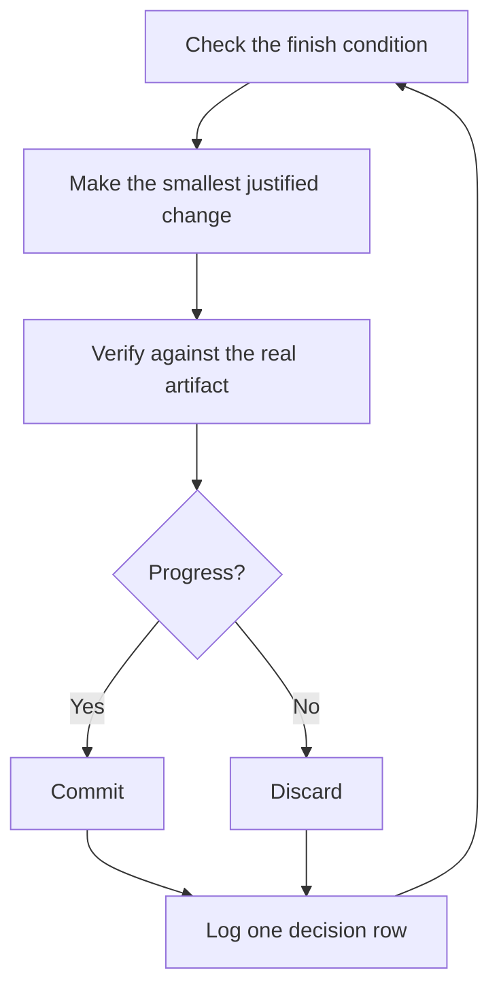

# Run work while you sleep

This is the payoff for everything before it. An agent you can trust to verify its own work is an agent you can leave alone with a hard task. What makes that safe isn't hope. It's a checkable finish condition, an isolated worktree with owned runtime resources, and a decision log you audit in the morning.


The illustration retains the original command labels. Use the jstack commands in the text; Cursor's `/loop` is not a jstack command.

## Earn the trust before the loop

A loop you don't trust just produces unchecked work faster, and the mess compounds with every iteration. Before you leave one running, check that it has earned it:

- You've done the task once by hand, or watched an agent do it, so you know what good looks like.
- The agent has the tools and signals you'd use yourself: the verification skill, the profiler, the logs.
- Every stage proves its work and can stop the line when the work misses the bar.
- You've read a few transcripts and turned the repeated failures into tools, skills, or checks.

Make the loop autonomous only after all four hold. Until then, run it while you watch.

## The overnight contract

A good handoff has the goal, the finish condition, permissions, and an escape hatch. It doesn't need to be long:

```text
/jstack-juan-mode im going to bed. migrate every caller to the new parser in a fresh worktree off <base>.
done means zero old callers, all parser fixtures pass, old api deleted.
keep a decision log. don't ask me before committing.
continue until done. if you're truly stuck after a few hours, stop and write up why.
```

Walk through what each line buys you:

- "im going to bed" requests continued authorized work. It does not answer a required user decision or expand merge, installation or external-action permission.
- "done means..." turns the goal into checks every iteration can run.
- "fresh worktree off `<base>`" keeps the run from colliding with anything else you have open.
- "don't ask me before committing" pre-answers the permission the agent would otherwise block on.
- T3 wake and schedule capabilities must be discovered and explicitly configured when needed. The [Autonomous run playbook](https://github.com/juancamiloqhz/skills/blob/main/skills/jstack/jstack-juan-mode/playbooks/autonomous-run.md) owns the completion checks and recovery behavior. A prompt saying "continue" is not proof that a background scheduler exists or survives a restart.
- The escape hatch lets it stop at a genuine dead end and write up why, which beats eight hours of creative goal reinterpretation.

Because you'll review this work after stepping away, `/jstack-juan-mode` routes it through [`/jstack-figure-it-out`](https://github.com/juancamiloqhz/skills/blob/main/skills/jstack/jstack-figure-it-out/SKILL.md), which designs the run's phases before any code and wires in the decision log.

To stop a run on purpose, tell the agent to pause, or that you're about to go offline or restart the provider. The [Pause safely playbook](https://github.com/juancamiloqhz/skills/blob/main/skills/jstack/jstack-juan-mode/playbooks/pause-safely.md) finishes or backs out of the current step, commits a work-in-progress checkpoint, and writes a resume note. A fresh chat picks the work up from that note through the Session pickup playbook. Saying "keep going" never triggers a pause.

## What the loop does all night



One change, one check, one log row, every iteration. Changes that didn't help get discarded, not left to ride. A plateau means pivot, not stop, and the finish condition never quietly relaxes to declare victory.

## The morning audit

[`/jstack-show-me-your-work`](https://github.com/juancamiloqhz/skills/blob/main/skills/jstack/jstack-show-me-your-work/SKILL.md) is what makes the run reviewable. Each row records the time, phase, decision, reason, an evidence pointer, and the result, in a TSV at `decisions.tsv` (or `.audit/<task-slug>.tsv` when several runs share a directory). It stays local by default. Commit it when the work is ambitious enough that a reviewer needs the trail to trust the result.

When you're back, ask for the run in review form:

```text
/jstack-show-me-your-work catch me up on what you did last night
```

Before handing back, the skill dispatches the configured `judgment and prose` reviewer to check the trail and available transcript or bounded digest. It reports the actual reviewer and reduced independence for inherited/same-family selections; it does not silently choose another model. Its Attention section names the remaining flags or unavailable review. Read that section first, then the referenced log rows.

For a quick status instead of an audit, run [`/jstack-ketchup`](https://github.com/juancamiloqhz/skills/blob/main/skills/jstack/jstack-ketchup/SKILL.md) in the chat that ran the work. It reads only and tells you in plain words what changed since your last message, with the screenshots and small diagrams the work produced. Then it lists each call waiting on you, such as a merge, an approval, or a choice between options, with its pick, evidence and risk, so you can decide from the reply alone.

## When the night holds a queue, not a task

The contract above drives one task to one finish condition. Some nights hold more, a queue of independent changes or a whole program. Three playbooks scale the same trust up.

[Autopilot-full](https://github.com/juancamiloqhz/skills/blob/main/skills/jstack/jstack-juan-mode/playbooks/autopilot-full.md) runs a queue of independent PRs to merged. Each PR gets one owner agent that carries it from build through merge, and no owner merges on its own verdict. A swarm of fresh verifiers checks the owner's code-ready head. A later rebase or minor fix gets one fresh verifier, and only new behavior or a large new diff calls the full swarm again. Only a clean verdict on the patch that merges authorizes the merge:

```text
/jstack-juan-mode full autopilot on this queue. each item is independent. i want them merged by morning.
```

[Autopilot-stack](https://github.com/juancamiloqhz/skills/blob/main/skills/jstack/jstack-juan-mode/playbooks/autopilot-stack.md) runs the same owner loop but ships nothing. You wake up to one linear base-branch stack with a verifier's verdict on every link, and you review and land it yourself. Pick it over Autopilot-full when the changes are coupled, or when you want your own eyes on the work before anything merges:

```text
/jstack-juan-mode autopilot these five changes but stack them, don't ship. i'll land the stack in the morning.
```

[Orchestrate](https://github.com/juancamiloqhz/skills/blob/main/skills/jstack/jstack-juan-mode/playbooks/orchestrate.md) is for a program that outlives any single agent: multi-day, many stacked PRs, fleets of subagents under one standing coordinator chat. The coordinator authors briefs, collects what its subagents finish, keeps the lowest unmerged PR green, and never writes code itself. It's deliberately heavy machinery. If one agent could finish the work in a session, the playbook itself routes you back to the overnight contract above:

```text
/jstack-juan-mode orchestrate the store migration. own it until every package is converted and merged. i'll check in twice a day.
```

## Run many projects in parallel

T3 projects group work, while an ordinary coordinator conversation can own delegated tasks. Orchestrate uses that standing coordinator and its explicit briefs. New top-level conversations are created only when requested; child work uses the supported delegation tools and separate workspaces as needed. A project does not by itself promise cloud execution, shared access to every chat, or work continuing after a host shutdown. Provider recovery and wake behavior need actual evidence.

A few habits help:

- Keep independent bodies of work in clearly scoped coordinator conversations and workspaces; several can run side by side within actual capacity.
- Supply relevant handoffs and source pointers explicitly. Project membership does not prove every agent has read the related chats.
- Give each PR a verification swarm before it merges, and let Autopilot-stack or Autopilot-full carry the queue.
- Ask the coordinator for a plan backed by data, and have it answer open questions with prototypes before it asks you.

One prompt can carry a whole Project, from research through execution:

```text
/jstack-juan-mode refactor this repo so its architecture is more agent friendly. use /jstack-correct and /jstack-architect on past commits and review comments to find the mistakes agents make most here. use /jstack-recall for context from past chats. answer open questions with prototypes instead of asking me. come back with a plan backed by real data. once i approve it, run it with autopilot-stack or autopilot-full, and ask me which.
```

## Let loops start themselves

Every loop above still waits for you to start it. A scheduled or event-driven automation removes that step. Software maintenance splits into stages that suit this well: triage a report, reproduce it, fix it, verify the fix. Two rules keep such a line trustworthy:

- Every stage can stop the line. Triage can decide the report is expected behavior, repro can fail to reproduce it, and the fixer can judge the change too risky. Each of those outcomes is useful, because it keeps bad work from reaching the next stage, where it costs more to undo.
- Every stage hands over evidence. Repro attaches screenshots and video of the broken state, and the fix attaches before-and-after proof. A human can then check that the agent fixed the right thing before reading a line of code.

Jstack includes a dormant [Benny automation pack](https://github.com/juancamiloqhz/skills/tree/main/automations/jstack/benny) for Slack issue reports. Its source defines triage and reproduction workflows; no Slack intake, tracker adapter or live task is installed by having these files. The [setup entry](https://github.com/juancamiloqhz/skills/blob/main/automations/jstack/benny/FOR_AGENTS.md) is a direct-read procedure, not a catalog slash skill. Setup requires selected repository, Slack and tracker targets, project-scoped dependencies, reviewed drafts and separate live authorization. The live pilot remains deferred while those targets are unselected. Reading this guide does not enable it or create a schedule.

**Pitfall:** a duration is not a finish condition. "work on this for 4 hours" gives the agent nothing to check, and you'll wake up to four hours of motion instead of a result. Give the run a predicate that can pass or fail.

Next: [Steer with principle names](./08-principles.md).
